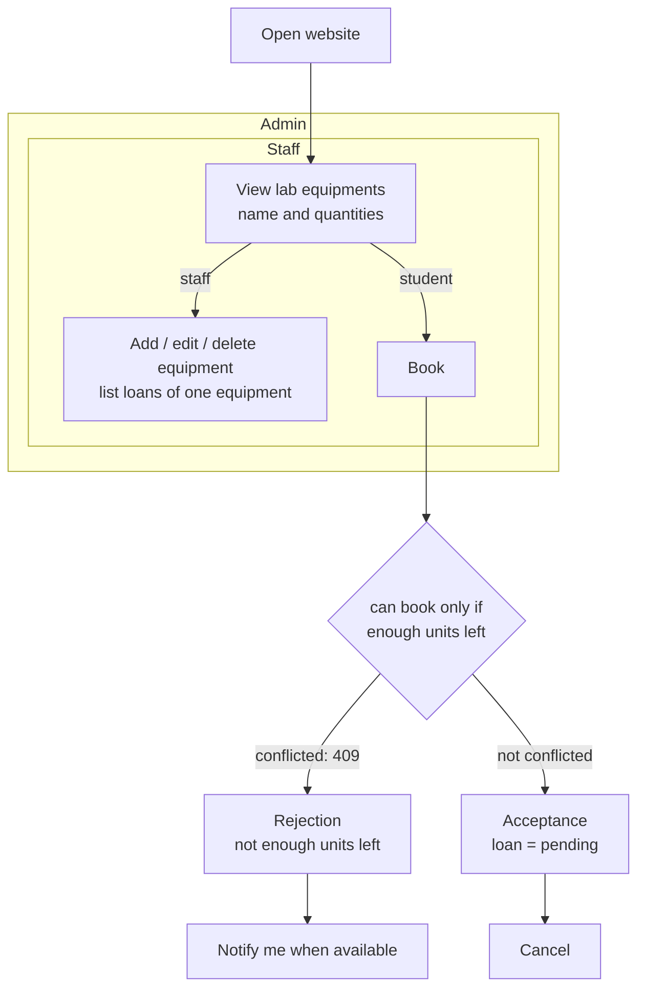
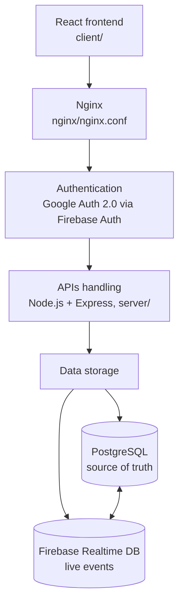
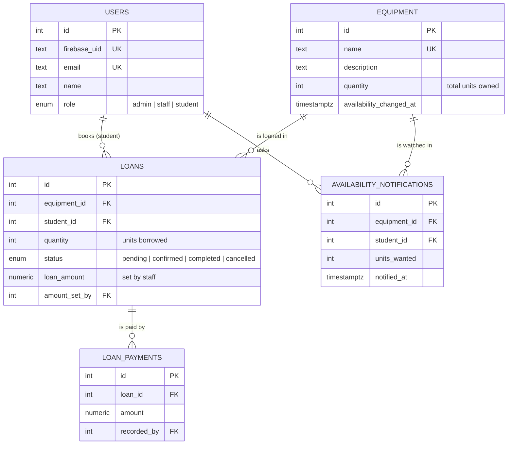

# Lab-Mid (Advanced Web Technologies) — Design → Implementation

This document follows my paper solution section by section and shows where each part lives in the code.

## 1. Variant

| Variant | Catalogue resource (A) | Booking resource (B) | Rule that returns 409 | Live event name |
|---|---|---|---|---|
| **0** | Lab Equipment (quantity) | Loan | not enough units left | `availability:changed` |

## 2. Application diagram



In the app: **Lab Equipment** tab → each card has *Book*; a 409 shows the red **Rejection (409)** box with
**Notify me when available**; success shows the green **Acceptance** box with **Cancel**
(`client/src/components/EquipmentPage.jsx`).

## 3. Infra diagram



- **React → Nginx**: Nginx serves the built React app and proxies `/api` to Node (`nginx/nginx.conf`).
  In development Vite does the same proxying (`client/vite.config.js`).
- **Authentication**: the browser signs in with Google (OAuth 2.0) through Firebase Auth; every API call
  sends the Google ID token, which the API verifies (`server/src/middleware/auth.js`).
- **PostgreSQL ↔ Firebase**: after every change is committed in PostgreSQL, the API publishes the
  event to Firebase Realtime Database, which pushes it to browsers (`server/src/services/events.js`).

## 4. Data model (ERD)



**Units left** is never stored, it is calculated:
`units left = equipment.quantity − SUM(loans.quantity WHERE status IN ('pending','confirmed'))`.
Completed and cancelled loans give their units back. Full SQL: `database/schema.sql`.

## 5. API contract sheet (10 APIs)

Base URL `/api`. All need `Authorization: Bearer <Google ID token>` except the public `/meta` ones.

| # | API (from my paper) | Endpoints |
|---|---|---|
| 1 | Login / sign-in (Google Auth 2.0) + roles | `GET /auth/me` · admin: `GET /users`, `POST /users`, `PATCH /users/:id/role` |
| 2 | Lab equipment (A) — full CRUD | `GET /equipment` *(cached)* · `GET /equipment/:id` *(cached)* · `POST /equipment` · `PUT /equipment/:id` · `DELETE /equipment/:id` |
| 3 | Number of lab equipments left | `GET /equipment/:id/availability` |
| 4 | Availability changed or not | `GET /availability/changes?since=<ISO time>` |
| 5 | Loan (B) | `POST /loans` · `GET /loans` · `GET /loans/:id` · `GET /equipment/:id/loans` *(nested URI)* · `POST /equipment/:id/notify` |
| 6 | Loan set by staff | `PATCH /loans/:id/status` · `PATCH /loans/:id/amount` |
| 7 | How much loan paid (to loan set by staff) | `GET /loans/:id/payments` · `POST /loans/:id/payments` |
| 8 | Error API (409) | Every error uses one shape; catalogue at `GET /meta/errors` |
| 9 | Live update of changes to UI | Firebase Realtime DB channels (section 7); catalogue at `GET /meta/events` |
| 10 | API for interconnection of all | `GET /overview` (equipment + loans + availability + payments in one call) |

### Request / response details

| Method & path | Who | Body | Success | Errors |
|---|---|---|---|---|
| `GET /auth/me` | any signed-in | — | `200 {id, uid, email, name, role}` | 401 |
| `GET /equipment` | all | — | `200 [{id, name, description, quantity, unitsOnLoan, unitsLeft, availabilityChangedAt}]` + `ETag`, `X-Cache` | 401 |
| `GET /equipment/:id` | all | — | `200 {…equipment}` | 404 |
| `POST /equipment` | staff, admin | `{name, description?, quantity}` | `201 {…equipment}` | 400, 403, 409 `DUPLICATE` |
| `PUT /equipment/:id` | staff, admin | `{name?, description?, quantity?}` | `200 {…equipment}` | 403, 404, **409 `CAPACITY_CONFLICT`** |
| `DELETE /equipment/:id` | staff, admin | — | `204` | 403, 404, **409 `EQUIPMENT_HAS_ACTIVE_LOANS`** |
| `GET /equipment/:id/availability` | all | — | `200 {equipmentId, quantity, unitsOnLoan, unitsLeft, available}` | 404 |
| `GET /equipment/:id/loans?status=` | staff, admin | — | `200 [loan]` | 403, 404 |
| `POST /equipment/:id/notify` | student | `{units}` | `201 {id, unitsWanted, message}` | 400, 403, 404 |
| `GET /availability/changes?since=` | all | — | `200 {since, checkedAt, changed: bool, equipment: […]}` | 400 |
| `POST /loans` | student | `{equipmentId, quantity, notes?}` | `201 {…loan, status: "pending"}` | 403, 404, **409 `NOT_ENOUGH_UNITS`** |
| `GET /loans?status=` | student = own, staff = all | — | `200 [loan]` | — |
| `GET /loans/:id` | owner, staff | — | `200 loan` | 403, 404 |
| `PATCH /loans/:id/status` | staff: forward moves · student: cancel own | `{status}` | `200 loan` | 403, 404, **409 `INVALID_STATUS_TRANSITION`** |
| `PATCH /loans/:id/amount` | staff, admin | `{amount}` | `200 loan` | 403, 404, **409 `AMOUNT_BELOW_PAID`** |
| `GET /loans/:id/payments` | owner, staff | — | `200 {loanAmount, amountPaid, remaining, fullyPaid, payments: […]}` | 403, 404 |
| `POST /loans/:id/payments` | staff, admin | `{amount}` | `201 loan` | 403, 404, **409 `PAYMENT_EXCEEDS_BALANCE`** |
| `GET /overview` | all (student = own data) | — | `200 {equipment, loans.byStatus, payments, recentLoans, links}` | — |
| `GET /users` · `POST /users` · `PATCH /users/:id/role` | admin | `{email, role}` / `{role}` | `200/201 user` | 400, 403, 404 |
| `GET /meta/errors` · `GET /meta/events` | public | — | `200 […]` | — |

A **loan** looks like:
`{id, equipmentId, equipmentName, studentId, studentEmail, quantity, status, loanAmount, amountPaid, remaining, createdAt, confirmedAt, completedAt, cancelledAt}`

### Error API (409)

```json
HTTP/1.1 409 Conflict
{
  "error": {
    "status": 409,
    "code": "NOT_ENOUGH_UNITS",
    "message": "Not enough units left: you asked for 3, only 1 of Digital Oscilloscope left",
    "details": { "equipmentId": 1, "requested": 3, "unitsLeft": 1 }
  }
}
```

| Code | When |
|---|---|
| `NOT_ENOUGH_UNITS` | Booking more units than are left (**the Variant 0 rule**) |
| `CAPACITY_CONFLICT` | Staff lower quantity below units currently on loan |
| `EQUIPMENT_HAS_ACTIVE_LOANS` | Deleting equipment that still has pending/confirmed loans |
| `INVALID_STATUS_TRANSITION` | Moving a loan backwards / out of a final state |
| `AMOUNT_BELOW_PAID` | Loan amount set lower than what is already paid |
| `PAYMENT_EXCEEDS_BALANCE` | Payment larger than the remaining balance |
| `DUPLICATE` | Equipment name already exists |

## 6. Auth & RBAC matrix (Google Auth 2.0 for login)

Everyone signs in with Google. A new account is a **student**; accounts in `ADMIN_EMAILS` are **admin**;
an admin promotes **staff** in the *Users & Roles* tab. Admin can do everything staff can, plus manage roles.

| Action | Admin | Staff | Student |
|---|:---:|:---:|:---:|
| Browse equipment, see units left, availability changes | ✅ | ✅ | ✅ |
| Create / update / delete equipment | ✅ | ✅ | ❌ |
| Book a loan | ❌ | ❌ | ✅ |
| See loans | all | all | **own only** |
| List loans of one equipment (`/equipment/:id/loans`) | ✅ | ✅ | ❌ |
| Confirm / complete a loan | ✅ | ✅ | ❌ |
| Cancel a loan | any | any | **own only** |
| Set loan amount, record payments | ✅ | ✅ | ❌ |
| See how much of a loan is paid | all | all | own only |
| Ask "notify me when available" | ❌ | ❌ | ✅ |
| Manage user roles | ✅ | ❌ | ❌ |
| Live: `availability:changed` | ✅ | ✅ | ✅ |
| Live: every loan change | ✅ | ✅ | ❌ (own only) |

Enforced in the API (`requireRole`, ownership checks in `server/src/routes/*.js`) **and** in Firebase
security rules for live channels (`firebase/database.rules.json`).

## 7. Real-time event catalogue

| Event | Firebase channel | Who receives it | Fired when |
|---|---|---|---|
| `availability:changed` | `live/public` | everyone signed in | equipment created / edited / deleted, or units left change (book, cancel, complete) |
| `loan:created` | `live/users/{uid}` + `live/staff` | the booking student + all staff/admin | a booking succeeds |
| `loan:updated` | `live/users/{uid}` + `live/staff` | **only the owning student** + all staff/admin | status change, loan amount set, payment recorded |
| `equipment:available` | `live/users/{uid}` | only the student who asked to be notified | units left reach what they wanted |

Every event is `{ type, …payload, at }`. The browser listens with `onChildAdded` (`client/src/live.js`)
and patches the screen — **no refresh needed**. Security rules make `live/users/{uid}` readable by that
user only, and `live/staff` by staff/admin only (role mirrored at `roles/{uid}`).

## 8. Caching plan

Browsing equipment is the most frequent read (Rule 6), so it is cached at three levels:

1. **API cache-aside** (`server/src/cache.js`): `GET /equipment` and `GET /equipment/:id` are served from
   memory. Response header `X-Cache: HIT | MISS` shows it working.
2. **Write-invalidate**: any change that affects the catalogue or units left (create, edit, delete, book,
   cancel, complete) clears the cache immediately, so users never see stale numbers. TTL (60 s) is a safety net.
3. **HTTP ETag**: responses carry an `ETag`; the browser revalidates with `If-None-Match` and gets
   `304 Not Modified` with no body when nothing changed.
4. **Nginx**: hashed JS/CSS bundles are cached for a year (`immutable`); `index.html` is always revalidated.

Live events keep open screens up to date, so the cache never has to serve "fresh" data by polling.

## 9. Rules every design must satisfy → where

| # | Rule | Where in code | Test |
|---|---|---|---|
| 1 | Staff full CRUD on A, students only read A | `routes/equipment.js` (`staffOnly`) | `Rule 1` |
| 2 | Student creates B, reads/cancels only own B | `routes/loans.js` (`requireRole('student')`, `loadVisibleLoan`) | `Rule 2` ×2 |
| 3 | Staff list all B, and B of one A via nested URI | `GET /loans`, `GET /equipment/:id/loans` | `Rule 3` |
| 4 | B moves forward only: pending → confirmed → completed or cancelled | `TRANSITIONS` in `services/loans.js` + DB trigger `loans_forward_only` | `Rule 4` |
| 5 | Breaking capacity / conflict → 409 | `POST /loans` (row lock `FOR UPDATE`), `PUT/DELETE /equipment` | `Rule 2 + 5`, `Rule 5 under load` |
| 6 | Browsing A is cached | `cache.js`, `sendCached` | `Rule 6` |
| 7 | Live changes; student gets only own; everyone sees availability | `services/events.js`, `client/src/live.js`, Firebase rules | `Rule 7` |

Tests: `server/test/api.test.js` (`npm test`), run against a real PostgreSQL database.
